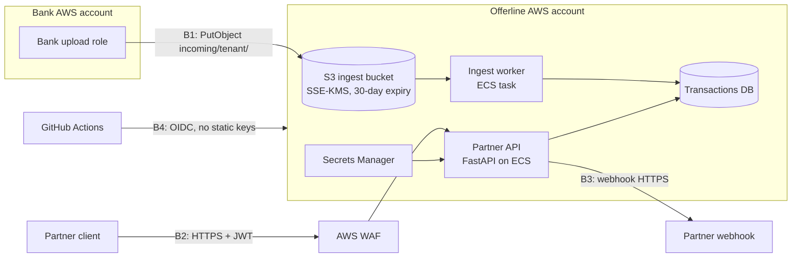

# Threat model: bank file ingestion and partner API

Method: data-flow diagram, then STRIDE at each trust boundary, then one
security requirement (SR) per mitigated threat, each with an owner and a test.
Done at design time, before the routes existed, so findings changed the design
instead of becoming bug tickets. Reviewed again whenever a new data flow or
trust boundary is added (a checkbox on the PR template).

## 1. What we're protecting

| Asset | Why it matters | Classification |
|---|---|---|
| Bank transaction records | Partner banks' customer data; a leak ends the partnership | Confidential |
| Card numbers | PCI scope if we ever store a full PAN | Restricted (we only accept last 4) |
| Partner API tokens / JWT signing secret | Signing secret = forge any partner | Secret |
| Offer and cashback data | Business-sensitive, lower impact | Internal |

## 2. Data flow and trust boundaries

| Boundary | Crossing | Who's on the other side |
|---|---|---|
| B1 | Bank account to our S3 bucket | Each bank, via a cross-account role |
| B2 | Internet to the partner API | Partner servers holding a JWT |
| B3 | Our API to a partner-supplied URL | Whatever the URL points at |
| B4 | CI/CD to AWS | Anyone who can run a workflow |

## 3. Threats (STRIDE) and decisions

| ID | STRIDE | Threat | Where | Likelihood × impact | Requirement |
|---|---|---|---|---|---|
| T-1 | Spoofing | Forged token (alg=none, guessed weak secret, wrong audience) | B2 | Med × Critical | SR-1 |
| T-2 | Spoofing | Bank A writes a file into bank B's prefix | B1 | Low × High | SR-5 |
| T-3 | Info disclosure | IDOR: partner changes account_id to another bank's | B2 | **High × Critical** | SR-2 |
| T-4 | Elevation | Read-only partner token used to change the webhook | B2 | Med × High | SR-3 |
| T-5 | Tampering | SQL injection through ids or filters | B2 | Low × Critical | SR-4 |
| T-6 | Info disclosure | Full card numbers arrive in a bank file and get stored or logged | B1 | Med × Critical | SR-7 |
| T-7 | Info disclosure / EoP | SSRF: webhook URL aimed at 169.254.170.2 (ECS task credentials) or 169.254.169.254 (EC2 metadata) | B3 | Med × Critical | SR-6 |
| T-8 | Repudiation | No record of which partner read which account | B2 | Med × Med | SR-8 |
| T-9 | Info disclosure | Stack traces in errors; responses cached by intermediaries | B2 | Med × Med | SR-9 |
| T-10 | DoS | Huge file or unbounded page size exhausts the worker | B1, B2 | Med × Med | SR-5, SR-9, WAF rate limit |
| T-11 | Tampering | Stolen CI credentials push a malicious image | B4 | Low × Critical | Platform: GitHub OIDC role limited to main + protected environment |

## 4. Security requirements

| SR | Requirement | Implemented in | Verified by | Owner |
|---|---|---|---|---|
| SR-1 | Verify signature, expiry, issuer, audience; pin algorithms; refuse secrets < 32 bytes | `app/auth.py`, `app/config.py` | `tests/test_authn.py`, Semgrep `jwt-decode-unsafe` | API team |
| SR-2 | Every object fetched by a caller-supplied id passes `authorize_account`; cross-tenant returns 404 | `app/authz.py` | `tests/test_authz.py`, Semgrep `account-route-missing-authz`, nightly `authz_probe.py` | API team |
| SR-3 | Each route requires one named scope | `app/auth.py` `require_scope` | `tests/test_authz.py::test_missing_scope_is_403` | API team |
| SR-4 | Parameterized SQL only | `app/db.py` | Semgrep `sql-built-from-strings`, ZAP SQLi rule set to FAIL | API team |
| SR-5 | Bank may write only its own prefix; key layout and tenant validated; size limit | `terraform/s3.tf`, `app/ingest.py` | `tests/test_ingest.py`, Checkov | Data platform |
| SR-6 | Outbound URLs: https, allowlisted host, port 443, resolves to public IPs only | `app/egress.py` | `tests/test_egress.py`, Semgrep `outbound-request-unvalidated-url` | API team |
| SR-7 | Reject files containing anything that looks like a full PAN; never echo it | `app/ingest.py` | `tests/test_ingest.py::test_full_pan_rejected_and_not_echoed` | Data platform |
| SR-8 | Log authorization denials with subject and object id, no transaction data; redact Authorization in WAF logs | `app/authz.py`, `terraform/waf.tf` | Code review | API team |
| SR-9 | Generic 500s; `Cache-Control: no-store`; security headers; bounded page size; API docs off in production | `app/main.py` | `tests/test_authz.py::test_limit_is_bounded`, ZAP baseline | API team |

## 5. What the model changed in the design

These are the decisions that came out of the session, before code existed:

1. **Tenant comes from the token, never the request.** The first draft of
   `GET /v1/offers` took `?tenant_id=`. T-3 made that a direct IDOR, so the
   parameter was removed (a test proves it is ignored).
2. **404 instead of 403 for other tenants' objects**, so ids can't be
   enumerated to learn which accounts exist at other banks.
3. **We don't accept full card numbers at all.** The alternative was
   "store, then mask". Rejecting at ingest keeps us out of PCI storage scope.
   That changed the file contract with banks: they send `card_last4` only.
4. **Webhooks became an allowlist of registered hosts**, not free-form URLs,
   plus resolved-IP checks as a second layer, and an egress proxy in production (T-7).
5. **Deploys use OIDC with a role pinned to one repo and a protected
   environment** (T-11), so there are no AWS keys in GitHub to steal.

## 6. Accepted risks

- Cross-region replication of the ingest bucket is off (SEC-142): files are
  transient and the bank holds the source copy.
- JWT secret rotation is manual until the rotation Lambda ships (SEC-151, expires 2026-11-30).
